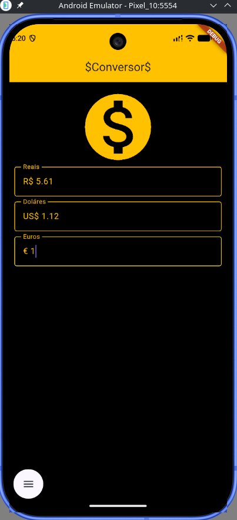

# 🪙 Conversor de Moedas

Um aplicativo simples e direto desenvolvido em **Flutter** que realiza a conversão em tempo real entre **Real (BRL)**, **Dólar (USD)** e **Euro (EUR)** consumindo a API de finanças da [HG Brasil Finance](https://hgbrasil.com/).

---

## 📸 Demonstração

<p align="center">
  
</p>

---

## 🚀 Funcionalidades

- **Cotação em tempo real**: Consulta automática dos valores de compra do Dólar e do Euro via requisição HTTP.
- **Conversão reativa**: Altere o valor em qualquer um dos campos (Real, Dólar ou Euro) e os demais são recalculados instantaneamente.
- **Feedback de status**: Exibição de tela de carregamento e mensagem amigável caso ocorra falha na conexão com a API.
- **Tema escuro**: Interface contrastante com tema Dark e detalhes em âmbar.

---

## 🛠️ Tecnologias Utilizadas

- [Flutter](https://flutter.dev/) - Framework multiplataforma
- [Dart](https://dart.dev/) - Linguagem de programação
- [http](https://pub.dev/packages/http) - Pacote para consumo de requisições HTTP REST
- [HG Brasil Finance API](https://hgbrasil.com/) - Provedor de cotações financeiras

---

## 📦 Como Executar o Projeto

### Pré-requisitos

- [Flutter SDK](https://docs.flutter.dev/get-started/install) instalado na sua máquina
- Um emulador Android/iOS configurado ou um dispositivo físico conectado via USB
- Chave de API da [HG Brasil](https://hgbrasil.com/) (gratuita)

### Passo a passo

1. **Clone este repositório:**
   ```bash
   git clone [https://github.com/seu-usuario/conversor_app.git](https://github.com/seu-usuario/conversor_app.git)
   cd conversor_app